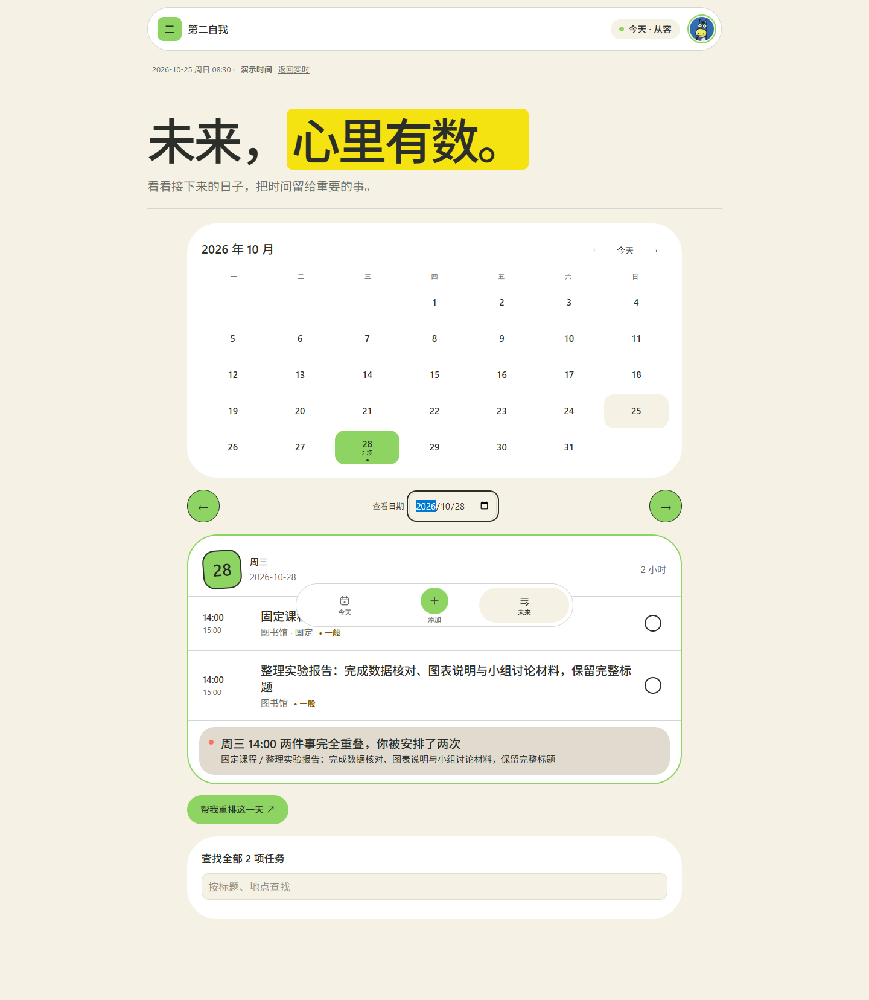

# 第二自我 · 校园日程与冲突规划助手

杨家凯 · 福州大学至诚学院 · B组个人作品

把群通知里的时间整理成日程，先发现撞车，再由你选择怎么调整。今天 / 添加 / 未来共用一套数据和真实业务逻辑；根路径是唯一正式应用，旧 /planner 自动回到首页。



## 10分钟复现

环境：Node.js 22.11–24.x（本次实测24.14.0）、npm；无数据库，无账号。联网安装依赖，之后无需密钥可体验规则文本解析、本地冲突检测、确定性重排。

```sh
git clone https://github.com/jayk067123-max/second-self.git
cd second-self
npm ci
npm run dev
```

打开 http://localhost:3000 。端口占用时：npm run dev -- --port 3018 。

1. 首次打开是空日程，正常显示空状态。
2. 「添加」粘贴通知或点图片入口的绿色加号上传截图。核对日期、时间和任务，确认后才入库；缺信息可补充。
3. 「未来」选择有冲突的日期：点「帮我重排这一天」→「生成重排方案」，选择一套，对比原安排与调整后时间，再点「采用这套安排」；关闭面板可撤销。
4. 「添加」粘贴：2026-10-25 14:00-15:00 小组讨论。核对日期并确认入库，到「未来」10月25日查看。
5. 点击任务编辑、删除；勾选完成；到头像设置导出JSON再导入，刷新验证保存。导入与清空先询问，并可撤销。
6. 生产页面已删除「载入演示数据」「填入示例」。仅供评审复现的固定样例仍在docs/demo-fixtures/demo-seed.json，可通过设置的「导入 JSON」打开；其时钟明确标注演示，可返回实时，不自动删除已有日程。

生产模式：npm run build，然后npm run start。完整质量门：npm run verify。真实AI配置与验收见docs/AI-SETUP.md。

Windows可在源码目录打开终端，按上述命令启动；无node_modules时先npm ci。

## 模型设置（可选）

复制.env.example为.env，只在服务端填写LLM_BASE_URL、LLM_API_KEY、LLM_MODEL。服务商须兼容OpenAI Chat Completions；图片入口还须模型支持图像输入。重启服务使配置生效。

| 状态 | 行为 |
|---|---|
| 未配置密钥 | 文本使用规则解析，重排使用本地确定性算法；重排结果保留本地方案提示 |
| 图片且无密钥 | 明确失败并提示配置多模态模型，不返回假识别结果 |
| 已配置密钥 | 服务端调用模型，JSON结构和业务约束校验后返回候选，人工确认才入库 |
| 模型重排全部不合法 | 返回否决原因并尝试本地可行方案；无解时提示手动调整 |

DeepSeek官方配置示例（2026-10-25核对）：LLM_BASE_URL=https://api.deepseek.com，LLM_MODEL=deepseek-flash。该模型支持文字和图片；官方接口请求关闭思考以保留JSON字段输出预算。密钥放本机.env.local或部署平台的服务端环境变量，勿放前端或公开包。官方能力与账号实际可用性仍需分别验证。

2026-10-25真实小样本：两行合成文字及对应图片各解析2条，日期、时段核对正确；重排2套通过，1套因缓冲冲突被规则拒绝。首测解析因repeat契约失败，补齐提示词后通过，失败记录保留。此为连通性与契约检查，不代表普遍准确率，费用未统计。见docs/verification/live-ai；/api/health本身只说明配置状态。

## 核心功能

- 文字/图片统一整理，桌面分步弹窗、手机底部面板；补充信息 → 时间线核对 → 确认入库。绿色返回键恢复上一步；关闭后可继续。手动新增兜底。
- 时间重叠、通勤缓冲不足、日负荷和截止逼近四类确定性规则；地点未知时保守提示，阈值是产品规则而非健康建议。
- 月历、任意日期、标题/地点搜索；周重复与学期周次过滤；周期完成按天记录。编辑周期任务影响整组，删除整组前确认。
- 未来日期重排传入全量约束。固定/周期/已完成安排不可自动移动，不排入过去；写回前再校验，数据变化后旧方案失效。
- 新增/编辑/删除/重排/导入/清空统一单步撤销；JSON迁移校验与本地持久化；存储受限会提示备份。
- 六个内置头像或本地上传，支持用户名设置；设置已移除学期开始日。固定安排有简短说明：自动重排不移动，仍可手动编辑；奶油底、草绿、黄色标题与14张SVG空状态插画，选不同日期随机更换且相邻不重复。优先级为轻松/一般/重要，响应式三标签、键盘焦点、原生对话框与减少动态支持。

## 结构与验证

src/app 路由与API；src/ui 页面和交互；src/domain 契约/纯函数；src/data 存储/迁移；src/ai 服务端模型编排；src/shared 共享工具。见docs/ARCHITECTURE.md。

2026-10-25最新：29个测试文件、378项测试、typecheck、eslint与生产构建通过；重排专项45项通过，四种尺寸、0个页面错误。历史完整界面回归261项与输入专项153项保留原日期和范围，本轮未全部重跑；补充信息与遗漏分支使用受控响应。详见docs/TEST-REPORT.md和verification/replan-checks.json。

## 数据与适用边界

任务存当前浏览器localStorage；无账号、无云同步、无系统推送。主动点击解析/重排才把相关原文、图片或任务字段发到应用服务端，配置模型后继续交由该服务商处理。请勿输入敏感个人信息。密钥不进入浏览器与仓库。

校园场景采用北京时间（Asia/Shanghai）；服务端配置固定此时区，浏览器应使用中国时区。跨时区旅行/夏令时不是本版保证范围。负载上限默认10小时，不代表适合每个人。

重排偏保守，不保证找到全局最优解；最多展示3个通过校验的候选，可能少于3个或无解。周期例外只支持按日完成，暂不支持单次调课例外；单次编辑影响系列。清除浏览器数据会丢日程，应定期导出。

## 演进与真实性

完整Git历史保留，未为了参赛改写早期作者。部分历史提交使用自动化工具身份，不能据此声称参赛者逐行手写或逐笔亲自确认。原始项目由AI代理辅助完成，本次继续在其基础上修复和整合。

证据在docs/prompts。现有000–007历史卡片含补记与明确缺口；008–010及session-excerpt记录实际融合与界面改进。**尚不能宣称已有至少3条完整原始核心Prompt链**，需从最初AI工具补导出。新录视频中的过程段是现存真实记录回放，不是伪造的现场输入。

正式介绍PDF、技术PDF及MP4随比赛交付包提供。未声明获得过奖项或完成过正式发表；此前是否公开发布/参赛获奖，须由参赛者本人核实后填写报名表。

代码许可证MIT；依赖许可证随npm包保留。六个头像来自参赛者提供的文档，其素材权利需本人确认，代码许可证不代为授予第三方素材权利。此仓库不附私人报名联系方式。

最新界面：删除两个参考按钮；每次只展开一套方案，完整显示任务与原日期/时间→新日期/时间，保留采用前校验及撤销。最新29文件378项单测、类型检查、ESLint和构建通过；重排专项45项、四种尺寸、页面错误0。浏览器复用本次真实响应检查交互，异常分支用受控响应，不等同额外模型实测。见docs/prompts/012-live-ai-and-replan-comparison.md。
